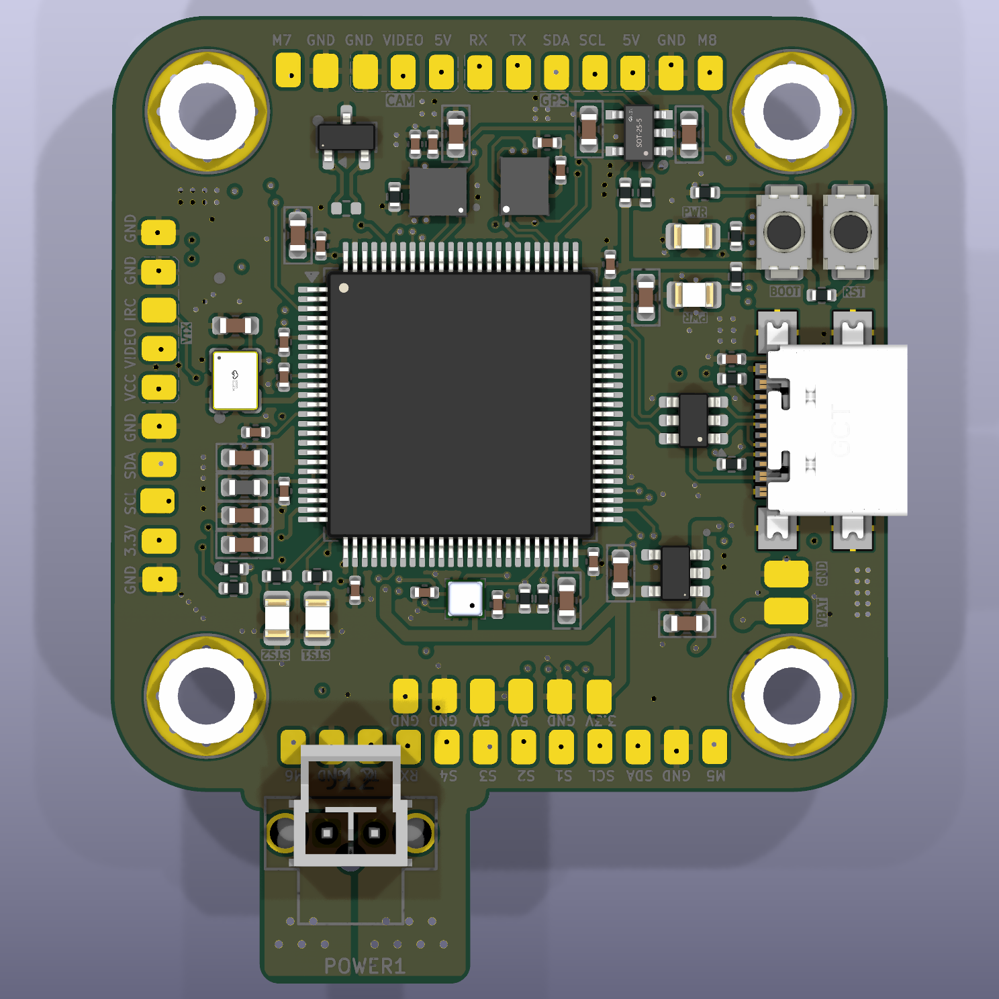
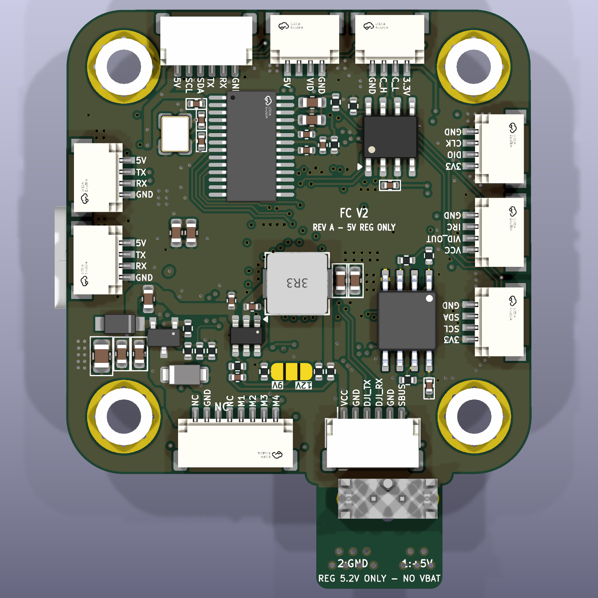
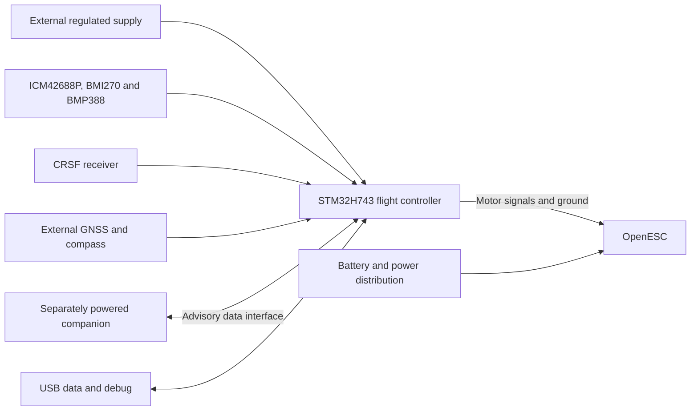
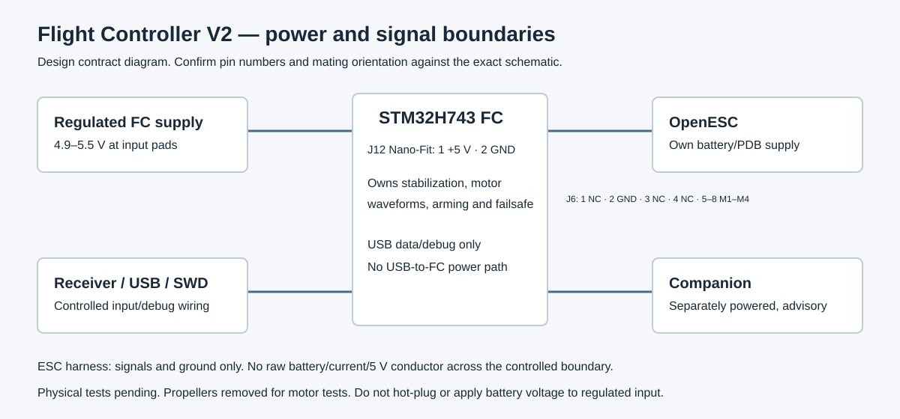

<p align="center">
  
  
</p>

<h1 align="center">Flight Controller V2</h1>

<p align="center">STM32H743 hardware adaptation and ArduPilot integration</p>

<p align="center">
  
  
  
  
</p>

---

STM32H743VIT6 controller adapted from an open-hardware reference design for externally regulated power, a signal-only OpenESC interface, exact Nano-Fit integration and a pinned ArduPilot target. The repository preserves the hardware adaptation, firmware work and vendor engineering packages.

**Project contributor:** [Desan Vasu](https://github.com/desanv01). Project engineering activities were performed by Desan; physical fabrication was external. Documented development: 26 August–6 October 2026. These are evidence dates, not employment dates.

> **Current status:** Engineering prototype. Manufacturer data, a pinned firmware target and freshly built FCV2 bootloader/BIN/APJ are available; powered-board, sensor and flight qualification remain pending.

**Quick links:** [KiCad project](hardware/Flight%20Controller.kicad_pro) · [Schematic PDF](docs/exports/schematic.pdf) · [Manufacturing](fabrication/README.md) · [Development history](docs/development/timeline.md) · [Verification](docs/validation-status.md) · [Releases](https://github.com/desanv01/Flight-Controller-V2/releases)

V2 is derived from [upstream hardware](https://api.github.com/repositories/1095062995), archived commit `0a60da1767061623549253d3cef8649f93ea052c`. Its original hardware design and contributors are credited below.

---

## Table of contents

- [Features](#features)
- [Hardware specifications](#hardware-specifications)
- [Architecture](#architecture)
- [Pin mapping](#pin-mapping)
- [Board layout and wiring](#board-layout-and-wiring)
- [Development history](#development-history)
- [Design and manufacturing files](#design-and-manufacturing-files)
- [Getting started](#getting-started)
- [Firmware](#firmware)
- [Verification](#verification)
- [Repository structure](#repository-structure)
- [License and credits](#license-and-credits)

---

## Features

- Reference-derived STM32H743VIT6 hardware with two dissimilar IMUs
- ICM42688P on SPI6, BMI270 on SPI3 and BMP388 on I2C2
- External regulated POWER1 supply; USB remains data/debug only
- Onboard AP63205 supply path removed; four signal-only OpenESC outputs
- Exact Molex Nano-Fit 105311-1202 on an integral connector tab
- Analog OSD hardware retained, disabled by initial firmware defaults
- Pinned ArduPilot Copter 4.7.1 source and neutral FCV2 target
- Separate JLCPCB and PCBWay source/manufacturing snapshots

---

## Hardware specifications

<details>
<summary>Full specifications and engineering status</summary>

| Parameter | Value |
|---|---|
| MCU | STM32H743VIT6, LQFP100 |
| PCB | 6 copper layers, 1.60 mm nominal |
| Design tool | KiCad 10.0.6 |
| Primary IMU | ICM-42688-P |
| Secondary IMU | BMI270 |
| Barometer | BMP388 |
| Power | External regulated input; exact boundary in power-and-interfaces documentation |
| USB | Data/debug; external controller power required |
| Motor signals | 4 controlled outputs |
| CAN | Retained CAN hardware; runtime qualification pending |
| Storage | W25Q128 flash |
| Board body | 40.5 × 40.5 mm main body |
| Mounting | 30.5 × 30.5 mm M3 |
| Overall envelope | About 40.575 × 50.500 mm including connector tab (vendor record) |
| Clock | 8 MHz active oscillator; HSE bypass |
| Fabrication status | Engineering data available; vendor/physical qualification outstanding |

</details>

Specifications describe the design intent and source. Runtime capabilities require physical qualification; see [validation status](docs/validation-status.md).

---

## Architecture



The controller owns stabilization, motor waveforms, arming and failsafe. Companion perception/navigation is advisory and separately powered. [Architecture and boundaries](docs/architecture.md).

---

## Pin mapping

Controlled J6 motor outputs map to PE14, PE13, PE11 and PE9 / TIM1. ICM42688P uses SPI6; BMI270 uses SPI3; BMP388 uses I2C2. [Resource matrix](docs/pin-mapping.md).

The [connector pin tables](docs/connector-pinouts.md) are generated from the exact public netlist. Do not infer connector numbering from another version or from an unlabelled photograph.

---

## Board layout and wiring

<p align="center"></p>

<p align="center"></p>

CAD renders above represent the published source, not photographs of tested hardware. [PCB layer and assembly exports](docs/exports/README.md) · [Power and interfaces](docs/power-and-interfaces.md) · [Bring-up procedure](docs/bring-up.md).

---

## Development history

The [timeline](docs/development/timeline.md) follows requirements, resource freeze, schematic capture, correction, placement, routing and manufacturing stages. Each milestone links its evidence and tag. Publication commits use their actual import date; historical dates remain in the records.

The [development archive](archive/README.md) preserves unique CAD experiments and engineering scripts, including failed approaches. Source fragments are labelled as fragments; no missing historical source state is fabricated.

---

## Design and manufacturing files

| Material | Location |
|---|---|
| Editable current KiCad source | [hardware/](hardware/README.md) |
| Browser-readable schematic and PCB drawings | [docs/exports/](docs/exports/README.md) |
| JLCPCB engineering source and assembly data | [fabrication/jlcpcb/](fabrication/jlcpcb/README.md) |
| PCBWay engineering source and assembly data | [fabrication/pcbway/](fabrication/pcbway/README.md) |
| Downloadable source-associated bundles | [Engineering releases](https://github.com/desanv01/Flight-Controller-V2/releases) |
| Historical sources and experiments | [Archive index](archive/README.md) |

Choose one version and vendor package as a complete set. Do not mix source, Gerbers, BOM or placement files across packages. New public manifests replace original private-package hashes after neutral naming and metadata changes.

---

## Getting started

1. Download or clone this repository.
2. Install KiCad 10 with its standard symbol, footprint and 3D libraries.
3. Open [Flight Controller.kicad_pro](hardware/Flight%20Controller.kicad_pro), then the root schematic and PCB.
4. Review [hardware instructions](hardware/README.md), [verification](docs/validation-status.md) and the correct [vendor package](fabrication/README.md).
5. Review the props-off [bring-up checklist](docs/bring-up.md) before any powered hardware work.

Build/flash guidance for the neutral FCV2 target is in [firmware/README.md](firmware/README.md). Keep initial runtime defaults and the unreserved board-ID limitation visible.

---

## Firmware

ArduPilot Copter 4.7.1 source is pinned to `dbe792162d06cab66c3475fd5556bf7a120f119e`. The [firmware directory](firmware/README.md) contains FCV2 target/defaults, reproducible build instructions, and the successful build logs, binary hashes and downloadable bootloader/BIN/APJ. Legacy upstream targets are historical; final EVT1 compatibility is not asserted.

---

## Verification

Fresh source checks: **14 October 2026**, KiCad **10.0.6**.

| Check | Result |
|---|---|
| ERC errors / warnings | 0 / 40 |
| DRC rule errors / warnings | 0 / 0 |
| Raw unconnected entries | 0 |
| Schematic parity issues | 0 |
| Physical qualification | Pending |


Publication metadata reconciliation removed the original 119 schematic/PCB parity warnings without changing pad, routing, placement, zone or outline geometry.

Ignored checker categories and warning dispositions are recorded in [validation status](docs/validation-status.md). EDA checks and a firmware build do not establish physical reliability or flight qualification.

---

## Repository structure

```text
hardware/       Current coherent KiCad source and libraries
firmware/       Target availability, configuration and build provenance
fabrication/    Vendor-specific source, assembly data and export instructions
docs/           Architecture, pinouts, development history and portfolio case study
media/          Exact-source CAD renders and layer views
verification/   Fresh native reports, corrections and exception evidence
tools/          Portable checking/export utilities
archive/        Recovered source states and indexed development experiments
```

---

## License and credits

Inherited upstream hardware source remains under [CERN-OHL-S-2.0](LICENSE). KiCad-derived libraries, ArduPilot and other third-party content retain their own notices. [Third-party notices](THIRD_PARTY_NOTICES.md).

Desan Vasu performed the project engineering activities; fabrication was external. [Contribution statement](CONTRIBUTIONS.md) · [Portfolio case study](docs/portfolio/case-study.md).

Reference projects: [ArduPilot](https://github.com/ArduPilot/ardupilot), [KiCad](https://www.kicad.org/), and the OpenESC/OpenRX ecosystem identified in the source records.

Related project: [Flight Controller V1](https://github.com/desanv01/Flight-Controller-V1).
