> Historical technical record. Names and private workstation/session references were neutralized for publication. Dates and assertions describe the recorded stage, not current physical qualification. See the current validation-status page for later checks.

# FC EVT1 — illustrated FC bring-up and Pi 5 integration guide

Illustrated edition prepared 5 October 2026; based on the original detailed procedure. This is an engineering test procedure, not a declaration that the manufactured boards or complete aircraft are flight-qualified.

## 1. Scope, evidence and immediate limits

## Visual navigation and phase tracker

This illustrated edition retains the full detailed procedure from the original guide and adds diagrams, branching decisions, wiring maps and unmarked checklists. No checkmark, diagram or documentation review means a hardware test has passed.

**Diagram convention:** arrows labelled with a voltage are power connections; arrows labelled SWD, UART, USB, I2C or MAVLink are signal paths. Connector drawings are logical pin maps, NOT photographs or mating-face views. Check real cavity numbering before wiring. Motor rotation is viewed from above.

Use the phase links below to move through the document. Checkboxes are editable tracking items; persistence and clickable checkboxes depend on your Markdown viewer. Mermaid diagrams require a Mermaid-capable preview; the pin tables and text wiring drawings remain readable without it.

| Phase | Work | Evidence needed before moving on |
|---|---|---|
| [A — inspection](#4-phase-a--incoming-inspection-and-manual-power1-assembly) | PCB, J12, continuity | Correct article and no unresolved assembly fault |
| [B — first power](#5-phase-b--first-fc-power-with-nothing-else-attached) | Bench supply, rails, temperature | Stable measured rails, no abnormal draw |
| [C — firmware](#6-phase-c--stlink-v3set-and-exact-firmware) | SWD, bootloader, APJ | Verified flash and identified custom firmware |
| [D — FC validation](#7-phase-d--mission-planner-sensors-and-receiver) | Sensors, orientation, receiver | Healthy calibrated sensing and pilot link |
| [E — power system](#8-phase-e--matek-bec12s-pro-and-battery) | UBEC, distribution | Measured 5.2 V, checked polarity and load behaviour |
| [F — propulsion](#9-phase-f--custom-esc-and-motors-propellers-off) | ESC, harness, motors | Verified mapping/protocol/directions without props |
| [G — installation](#10-phase-g--frame-installation-and-whole-aircraft-qualification) | Mounting, mass, thermal/power | Qualified mechanical and electrical installation |
| [H — perception bench](#11-phase-h--pi5-camera-ai-hat-and-one-satel) | Camera, Hailo, LiDAR | Real outputs, valid timestamps and fault tests |
| [I — communication](#12-phase-i--fcpi-communication-initially-read-only) | USB first, UART optional | Stable telemetry and reconnect behaviour |
| [J — avoidance development](#13-phase-j--detection-distance-and-avoidance-architecture) | Fusion, MAVLink, simulation | Correct observations and tested failure handling |
| [K — flight gates](#14-phase-k--final-gates-and-first-flight) | Independent review | All required aircraft tests completed |


### Roadmap: one completed gate at a time

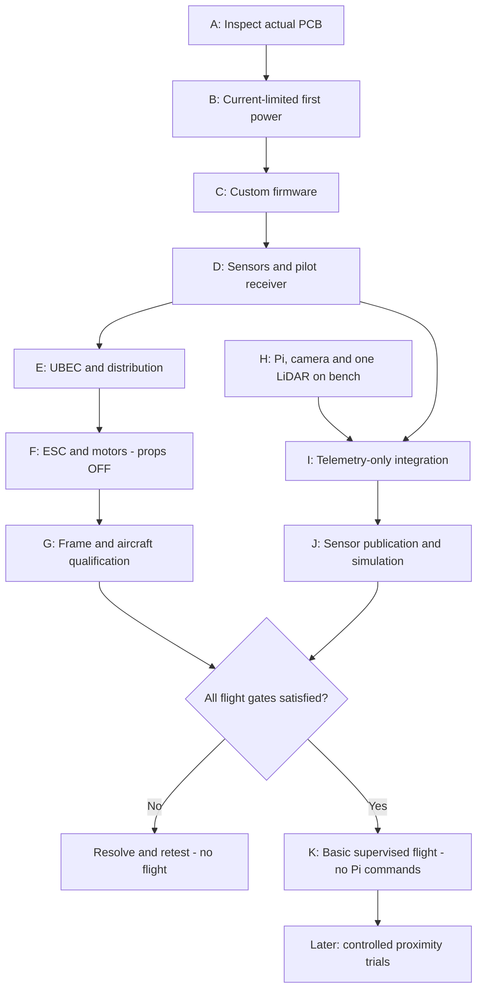


This guide covers incoming inspection, regulated power, STLINK-V3SET programming, Mission Planner/ArduPilot, receiver, Matek BEC12S-PRO, 6S battery, custom four-channel ESC, motors, frame installation, Raspberry Pi 5, AI HAT+, camera, ST VL53L5CX-SATEL, MAVLink, perception and staged flight integration.

No new photographs of the delivered FC were available in the request I received. Therefore solder quality, actual component orientation, connector installation, board revision and assembly substitutions have NOT been physically verified. Earlier JLCPCB renders are not photographs of the delivered board. Send clear top/bottom photographs, connector close-ups and the final assembly BOM before treating incoming inspection as passed.

The instructions below are based on the current local PCB, released EVT1 firmware and validation documents. I checked the current PCB's connector pad nets directly. An older verification XML netlist predates EVT1 and contains obsolete J6 power/motor assignments and J11 power; do not use it as a wiring guide. The current PCB and EVT1 connectivity assertions take precedence.

The three release firmware files currently match their SHA256 manifest. This proves local artifact integrity, not successful operation on the manufactured hardware.

Important uncompleted work:

- Physical FC power/sensor/orientation qualification.
- Exact delivered ESC pinout, firmware target, battery-voltage rating and current qualification.
- Battery voltage/current monitoring and associated failsafe: the released FC defaults deliberately disable it.
- Pi 5 compatibility testing of the ST LiDAR driver/platform layer.
- Actual navigation hardware and estimator configuration for position-controlled flight.
- Aircraft mass, thrust, power, cooling, vibration and flight testing.

## 2. Non-negotiable electrical rules

### Power domains: where battery voltage must stop

!Battery distribution and separate FC and Pi power domains (private source record)

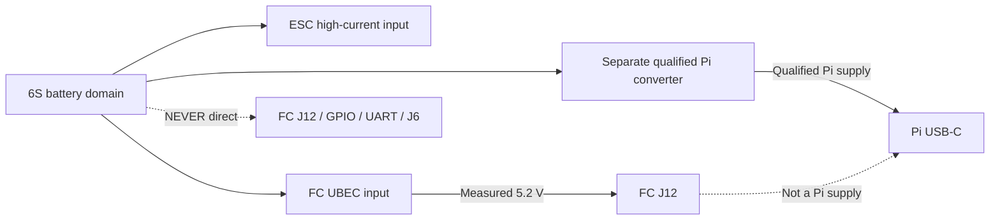


The dashed paths are **prohibited power connections**, not wires to install. Ground sharing does not permit joining regulator positive outputs.


1. Remove every propeller for all tabletop tests, programming and configuration. A software disarm command is not a substitute.
2. POWER1/J12 accepts regulated 5.2 V, not the flight battery. Never connect 6S directly to J12, J6, a UART or Pi GPIO.
3. FC USB-C is data-only in this release. It does not replace POWER1 power.
4. STLINK target-voltage reference is a voltage-sense input. Do not power the FC from the programmer.
5. J6 is a five-wire ESC signal harness: ground and four motor signals only. Pins 1, 3 and 4 remain empty.
6. J11 companion pin 1 is NC. It cannot supply the Pi.
7. FC and Pi need separate, qualified power branches; connect their signal grounds. Do not tie two regulator outputs together.
8. Carbon fibre conducts electricity. Insulate every PCB, exposed contact and high-current connection from the frame.
9. A 6S LiPo can deliver destructive fault current. Use current-limited supplies for early tests and an appropriate smoke stopper only for low-current initial battery checks. A smoke stopper is not suitable for loaded propulsion testing.
10. Stop immediately for heating, smoke, wrong polarity, excessive current, rail collapse, reset loops or uncertain connector numbering.

## 3. Workbench and recordkeeping

Prepare a multimeter, adjustable current-limited bench supply, insulated probes, magnification, ESD-safe handling, soldering tools, exact POWER1 hardware, verified cables, STLINK-V3SET, Windows computer, USB data cable and Mission Planner. An oscilloscope, suitable electronic load and thermal measurement are needed for full electrical qualification; a multimeter alone cannot prove transient stability or clean DShot waveforms.

Identify the boards FC-01 through FC-05. Bring up ONE board first. Keep the others unpowered until that procedure is proven; repeat inspection and basic acceptance on each rather than assuming the batch is identical.

For every test record board ID, date, firmware hash/version, parameter backup, supply voltage, current limit, measured rails/current, temperature, connected peripherals, result and any photos/logs. Never overwrite the only parameter backup.

## 4. Phase A — incoming inspection and manual POWER1 assembly

### Inspection decision tree

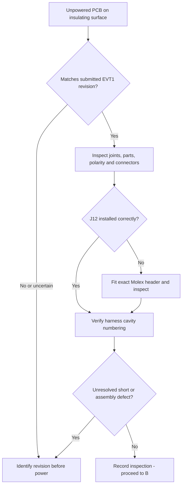


**Phase checklist — mark only after completing the physical test:**

- [ ] Actual board revision and assembly BOM compared
- [ ] J12 keying, solder and harness polarity verified
- [ ] Rail resistance and frame isolation checked

**PASS →** Proceed to the low-energy first-power test.

**STOP →** Do not energise an unidentified revision, reversed harness or suspected short.


### A1. Identify the delivered article

1. Lay the board on an insulating surface, disconnected from everything.
2. Photograph both faces square-on, then U7, sensors, USB, J3, J6, J11 and J12 close-up.
3. Compare the outline, silk labels and component positions with the submitted EVT1 manufacturing package, not an earlier 3D render.
4. Check the final JLCPCB assembly report against installed parts. In particular identify STM32H743VIT6/VIT6TR, ICM-42688-P, BMI270, BMP388, W25Q128 and the active 8 MHz oscillator.
5. Inspect MCU leads for bridges/lifted leads, connector joints and anchors, missing passives, solder balls, chipped parts and contamination.
6. Verify pin-1/polarity against the released pad numbering and actual component datasheet. Text orientation alone is not evidence. The earlier questioned D1, D4–D7, U9, U12 and Y1 deserve particular inspection; do not guess a rotation correction from a rendered magenta marker.
7. D3, U4 and L2 were removed in EVT1. Their absence is intended. An old design containing those parts is not this released power architecture.

Hidden QFN/LGA joints cannot be cleared by a photograph. Use functional tests and the assembler's inspection/X-ray records where appropriate.

### A2. POWER1 hardware

The board header is Molex Nano-Fit **105311-1202**, a two-circuit vertical through-hole header. The release excluded J12 from JLCPCB SMT assembly, so inspect whether it arrived unpopulated.

Compatible documented harness parts: housing 105307-1202, contacts 105300-2200 and TPA 105325-1002. A correctly specified premade mating assembly is acceptable after continuity/polarity verification.

If J12 is missing:

1. Confirm the exact header fits the footprint without force. Do not substitute an arbitrary two-pin connector.
2. Insert with its keyed orientation matching the footprint/model. Secure it without crushing the housing.
3. Solder both electrical pins and the mechanical solder clips. Heat the joint sufficiently for wetting without prolonged overheating or lifting pads.
4. Inspect both faces, remove compatible flux residue and inspect again.
5. Verify electrical continuity and no short between pins; do not use a solder bridge to attach wires.
6. Assemble and continuity-check the mating cable, including crimp retention and TPA engagement.

| POWER1/J12 cavity | Net | External connection |
|---|---|---|
| 1 | +5V | Regulated BEC/bench +5.2 V |
| 2 | GND | BEC/bench return |

Determine cavities by numbering/keying and pad continuity. The connector face and wire-entry face are mirrored views. Do not define polarity by a photograph's left/right or wire colour alone.

Use the released short 22 AWG harness concept: around 100 mm, maximum target 150 mm; leave the first 12.7 mm free before strain relief. Label it **REGULATED 5.2 V ONLY — NO VBAT**.

### A3. Unpowered checks

1. Confirm J12.2 to GND and J12.1 to the +5V testpoint with continuity mode.
2. Measure resistance +5V-to-GND and +3.3V-to-GND. Capacitors may cause a changing reading; a sustained near-short requires diagnosis. There is no universal pass resistance for this populated design.
3. Check that J6 unused cavities have not been accidentally bridged to power and inspect the depinned harness separately.
4. Check for frame/hardware shorts before mounting.
5. Do not apply a megohmmeter/high-voltage insulation tester to electronics.

Current PCB testpoint net map: TP1, TP4, TP25 and TP43 are +5V; TP22/TP27 are +3.3V; TP3/TP7/TP9/TP10/TP12/TP17/TP18/TP21/TP23/TP26/TP31/TP32/TP45 are GND. Confirm the physical pad in KiCad before probing. **TP14 is +VBAT, not a permitted 6S input or a validated battery-monitor input.**

## 5. Phase B — first FC power, with nothing else attached

### First-power pass/stop loop

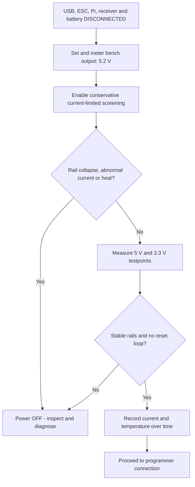


```text
BENCH +5.2 V ── verified cable ── J12.1 (+5V)
BENCH GND   ── verified cable ── J12.2 (GND)

Meter DC voltage: rail testpoint ↔ GND testpoint
Never put an ammeter directly across a supply rail.
```

**Phase checklist — mark only after completing the physical test:**

- [ ] Supply polarity metered before connection
- [ ] No unexplained sustained current limiting or heat
- [ ] 5 V / 3.3 V measured and startup behaviour recorded

**PASS →** Proceed to SWD programming.

**STOP →** Switch off first; distinguish a short from a startup transient before changing the current limit.


1. Disconnect STLINK, USB, receiver, ESC and battery.
2. With supply output disabled, set **5.2 V** and verify it at the cable with a multimeter.
3. Start with a conservative current limit, for example 0.1–0.2 A, as a fault-screening setting, not a specified board operating-current limit.
4. Connect the verified cable to J12, then enable output briefly while observing voltage/current and thermal behaviour.
5. If the supply limits and the rail collapses, switch off. Check resistance, polarity and hot components. A boot transient can exceed this screening limit, but do not keep increasing it blindly; establish a defensible operating limit after inspection.
6. If healthy, measure +5V and +3.3V at accessible testpoints, relative to GND. Check before and after firmware starts and with USB later attached.
7. Record quiescent current and run for several minutes, watching for a hot regulator/MCU, rising current or reset loop.

Acceptance: stable regulated rails, no abnormal heating/current, no resets; measurements recorded. A lit LED alone does not pass this phase. A 3.3 V regulator output should be close to its nominal value; use its component specifications to assess tolerance, not an invented universal range.

The existing engineering worksheet specifies a 4.9–5.5 V system rail under defined qualification loads, a 3 A continuous power-path test and 4 A/100 ms transient. These are **instrumented path-qualification tests with an appropriate external load**, not instructions to force 3 A through a bare FC or GPIO. Elevated-ambient qualification belongs in an equipped lab, not an improvised oven. USB backfeed measurement also requires a suitable breakout/instrument arrangement; never put an ammeter directly across VBUS and ground.

## 6. Phase C — STLINK-V3SET and exact firmware

### SWD setup: FC remains independently powered

!Exact FC J3 to STLINK-V3SET CN6 connections (private source record)

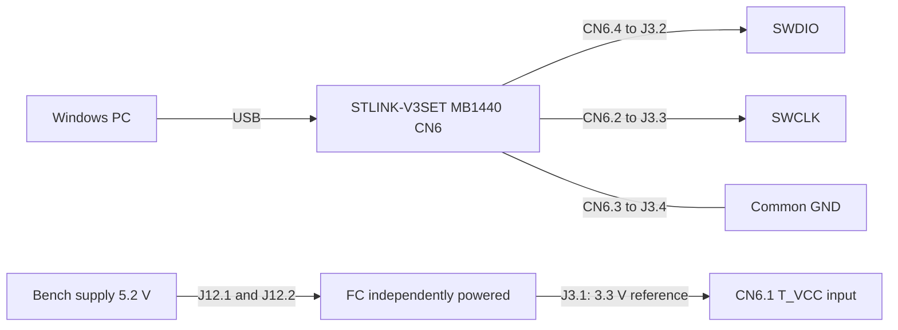


### Flash sequence and recovery branch

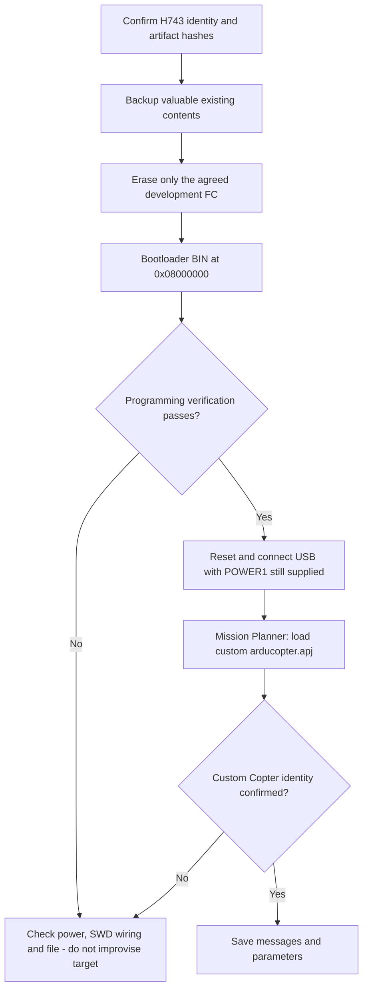


```text
STM32H743 FLASH — logical address map, not an erase command
0x08000000  ┌─────────────────────────────────────────┐
            │ Custom bootloader reservation: 128 KiB │
0x08020000  ├─────────────────────────────────────────┤
            │ Custom Copter application region       │
            │ APJ upload handles normal placement    │
            └─────────────────────────────────────────┘
```

**Phase checklist — mark only after completing the physical test:**

- [ ] STLINK connector type and four signal connections verified
- [ ] Bootloader programmed and verified
- [ ] Custom APJ loaded; version and parameter backup saved

**PASS →** Proceed to sensor validation.

**STOP →** No generic H743 firmware; no raw application BIN at the bootloader address.


### C1. Files and identity

All paths below are under:

`[LOCAL_SOURCE] DRONE PROJECT\work\FCV2-FC-RevA\FC_FAB_OUTPUT\ENGINEERING_VALIDATION_EVT1\firmware`

| Purpose | File | Verified SHA256 |
|---|---|---|
| SWD bootloader | binaries/FCV2_bl.bin | e20cc7e59ceb5503762b148c63981b79c15b8ef01f42494a9792c8854efcf8b8 |
| Mission Planner custom firmware | binaries/arducopter.apj | 23003d8c1bb64ac21be54da0a38e12a1b2687273e8f5773e48ff179bebf2d759 |
| Raw application, specialist recovery only | binaries/arducopter.bin | 6fb863c9490f6d8771ca4cdc60e4ef7fc75cf77c741fc14ecccb071cae355054 |

This is custom **FCV2 / Copter 4.7.1**, source dbe792162d06cab66c3475fd5556bf7a120f119e. APJ board ID 1241 is a local EVT1 assignment, not an upstream-reserved commercial board ID. Do not select a generic STM32H743, Cube or Pixhawk firmware, and do not install an unrelated bootloader just because the MCU matches.

### C2. SWD wiring

J3 is a four-pin FC connector, not a standard four-pin STLINK layout.

| FC J3 | Signal | STLINK-V3SET MB1440 CN6, six-pin wire connector |
|---|---|---|
| 1 | +3.3V reference | CN6.1 T_VCC, sense input |
| 2 | ST_SWDIO | CN6.4 T_SWDIO |
| 3 | ST_SWCLK | CN6.2 T_SWCLK |
| 4 | GND | CN6.3 GND |

CN6.5 NRST and CN6.6 SWO are not exposed on J3; leave them unconnected unless deliberately using a separately verified FC reset pad. Do not connect NRST to an arbitrary pin. STDC14 has a DIFFERENT numbering scheme: T_VCC 3, SWDIO 4, GND 5, SWCLK 6. The legacy 20-pin connector is different again. Identify the actual adapter/connector before wiring. See ST UM2448.

1. Unplug all power while building the harness. Verify each wire end-to-end; keep it short.
2. Install STM32CubeProgrammer and ST's USB drivers from ST. Connect STLINK to the PC and update probe firmware if required.
3. Power the FC independently with the proven 5.2 V bench supply. J3.1 should now measure approximately 3.3 V.
4. Select ST-LINK/SWD in CubeProgrammer, start at a modest SWD clock such as 100–400 kHz and connect.
5. Confirm STM32H743 identity and expected flash capacity before writing anything. If connection fails, first check VTref, common ground, swapped data/clock and reset state. Do not alter option bytes/readout protection to troubleshoot casually.

### C3. Flash

1. If the board contains valuable factory/user firmware, back it up before erasing. For an agreed blank development board, perform the released full internal-flash erase. This destroys existing application and stored parameters.
2. Select `FCV2_bl.bin`, start address **0x08000000**.
3. Program with verification enabled. Save the successful result.
4. Reset/power-cycle and disconnect STLINK for normal USB use.
5. Keep POWER1 powered and connect FC USB-C to the PC using a data-capable cable.
6. In Mission Planner use **Load custom firmware** and select `arducopter.apj`. Allow its bootloader connection/reset sequence to finish without removing POWER1.
7. Reconnect and confirm reported Copter 4.7.1 and custom target identity. Save boot messages and parameters.

The application region follows a 128 KiB bootloader reservation (0x08020000). Do not write `arducopter.bin` at 0x08000000. APJ loading is the normal path and handles application placement; raw-bin recovery should be deliberate, verified work rather than the first procedure.

Recovery: if no USB enumeration, check external power, cable, USB connector and verified bootloader. If SWD still connects, recheck artifacts and reset; do not replace the board target with a generic one. No bootloader response is not automatically a bad MCU.

## 7. Phase D — Mission Planner, sensors and receiver

### FC validation: sensors and pilot control are separate tests

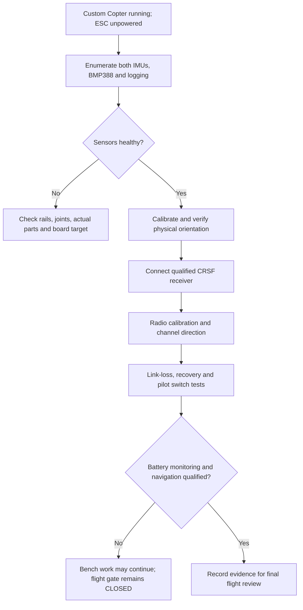


```text
CRSF RECEIVER                         FC J7
Supply rated for 5 V  <────────────── pin 1: +5V
Receiver TX            ─────────────> pin 2: FC RX
Receiver RX            <───────────── pin 3: FC TX
Receiver GND           ────────────── pin 4: GND

This is SERIAL2. Do not move it to SERIAL7 to follow a generic tutorial.
```

**Phase checklist — mark only after completing the physical test:**

- [ ] Both IMUs/barometer/logging actually tested
- [ ] Mounting orientation verified by physical movement
- [ ] Receiver directions and link-loss behaviour tested

**PASS →** Continue to power and ESC bench testing.

**STOP →** Flight remains blocked until required battery sensing, navigation and failsafes are qualified.


### D1. Initial configuration without propulsion

1. Connect over USB, download/save all parameters, inspect Messages and note every warning.
2. Check the release baseline. Do not copy the old `configs.param` dump.

| Parameter | Released bench value | Meaning/limit |
|---|---:|---|
| FRAME_CLASS | 1 | Quad |
| FRAME_TYPE | 1 | X |
| SERIAL2_PROTOCOL | 23 | RC input, USART3 |
| RC_PROTOCOLS | 512 | CRSF-only baseline |
| MOT_PWM_TYPE | 5 | DShot300, only after compatible ESC/output checks |
| SERVO1_FUNCTION ... SERVO4_FUNCTION | 33,34,35,36 | Motors 1–4 |
| SERVO_BLH_POLES | 14 | Assumption; verify actual motor poles before RPM use |
| SERVO_BLH_BDMASK | 0 | Bidirectional DShot disabled |
| SERVO_DSHOT_ESC | 1 | Released AM32/BLHeli32/Kiss command type |
| BATT_MONITOR | 0 | Battery sensing disabled; not a flight configuration |
| OSD_TYPE | 0 | Analog OSD disabled |

Do not mass-load these over an already calibrated configuration without reviewing changes. Save a new backup after each stage.

3. Confirm both IMUs enumerate: primary ICM-42688-P and secondary BMI270. Confirm BMP388 barometer and dataflash logging. The build explicitly supports ICM SPI6 via a non-DMA path; runtime health still needs checking.
4. Warm up stationary on a vibration-free surface. Perform the guided six-position accelerometer calibration with ESC power disconnected.
5. Set actual FC mounting orientation before flight. Both sensor definitions start at ROTATION_NONE; verify they report the same physical roll/pitch/yaw movement. Move the board deliberately forward tilt, right tilt and yaw and compare the HUD/logs. Sensor disagreement must be resolved, not hidden by disabling an IMU.
6. Check level calibration, stable pressure response and sensor health. Protect the barometer from propwash/light using suitable porous foam without sealing its pressure port or covering hot parts.
7. Download a log and confirm usable IMU/baro records, startup consistency and absence of resets. Dataflash capacity is finite; establish a download/erase policy.

### D2. ELRS/CRSF receiver

| FC J7 | Net | Receiver connection |
|---|---|---|
| 1 | +5V | Receiver supply only if its exact specification permits 5 V |
| 2 | FC RX, USART3 PD9 | Receiver TX |
| 3 | FC TX, USART3 PD8 | Receiver RX |
| 4 | GND | Receiver GND |

This uses SERIAL2. It is not the Pi companion port. Verify the receiver model, supply rating, pad labels, ELRS band/version and transmitter RF module compatibility; the parts list contains some potentially ambiguous radio listings. Use crossed RX/TX and a common ground.

1. Connect with all power off. Power the FC/receiver on the regulated branch.
2. Bind with the correct receiver/transmitter procedure; confirm telemetry and stable link.
3. In Radio Calibration verify roll/pitch/throttle/yaw channel direction, endpoints and neutral. Confirm low throttle is really low.
4. Assign flight modes and a clear pilot takeover/arming arrangement. Do not assign ordinary controls to ambiguous switches.
5. With props removed, test transmitter-off/link-loss behaviour and recovery. Verify the intended failsafe state in logs, not just an LED.

### D3. Navigation and battery monitoring are separate gates

The installed IMUs, barometer and camera object detector do not provide horizontal position. For outdoor Loiter/RTL/Auto/Guided, qualify a compatible GNSS/yaw source and EKF configuration. For indoor position flight, qualify a real external-navigation/VIO/optical-flow solution with appropriate height/yaw information. YOLO alone is not VIO.

J4 GPS port: 1 GND, 2 FC GPS_TX, 3 FC GPS_RX, 4 GPS_SDA, 5 GPS_SCL, 6 +5V. It maps to **UART8 / SERIAL6** in this custom build. Cross UART directions and verify the particular GNSS module's supply and 3.3 V logic compatibility. I2C pins are not RS232 or power pins; magnetometer support and driver configuration depend on the chosen module.

The released design does not expose a qualified 6S voltage/current measurement through J6; PC3 is not a current sensor. Before flight select and qualify an appropriate battery monitor (for example supported DroneCAN power module, qualified ESC telemetry, or a reviewed external sensing circuit). Calibrate against instruments, confirm readings under load and configure low/critical battery actions. Do not use FC 5.2 V as a proxy for flight-pack voltage. Do not fabricate BATT_VOLT_PIN/BATT_CURR_PIN settings or connect 6S to an ADC.

## 8. Phase E — Matek BEC12S-PRO and battery

### UBEC qualification before connecting the FC

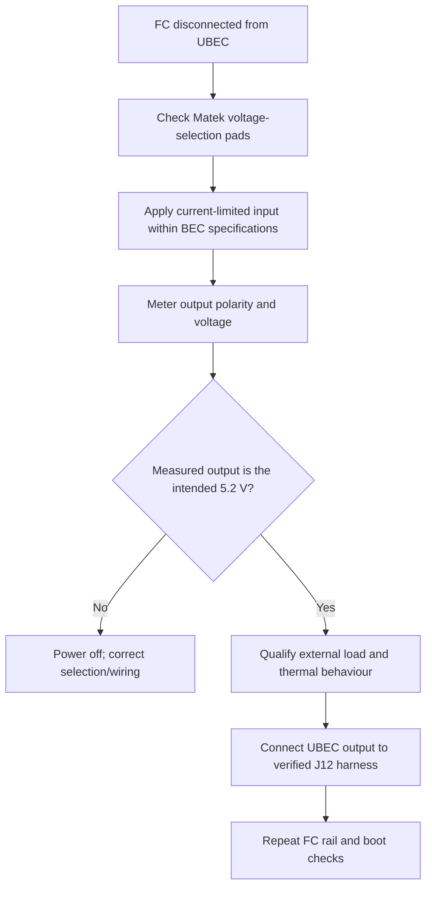


### Battery distribution: high-current and logic branches

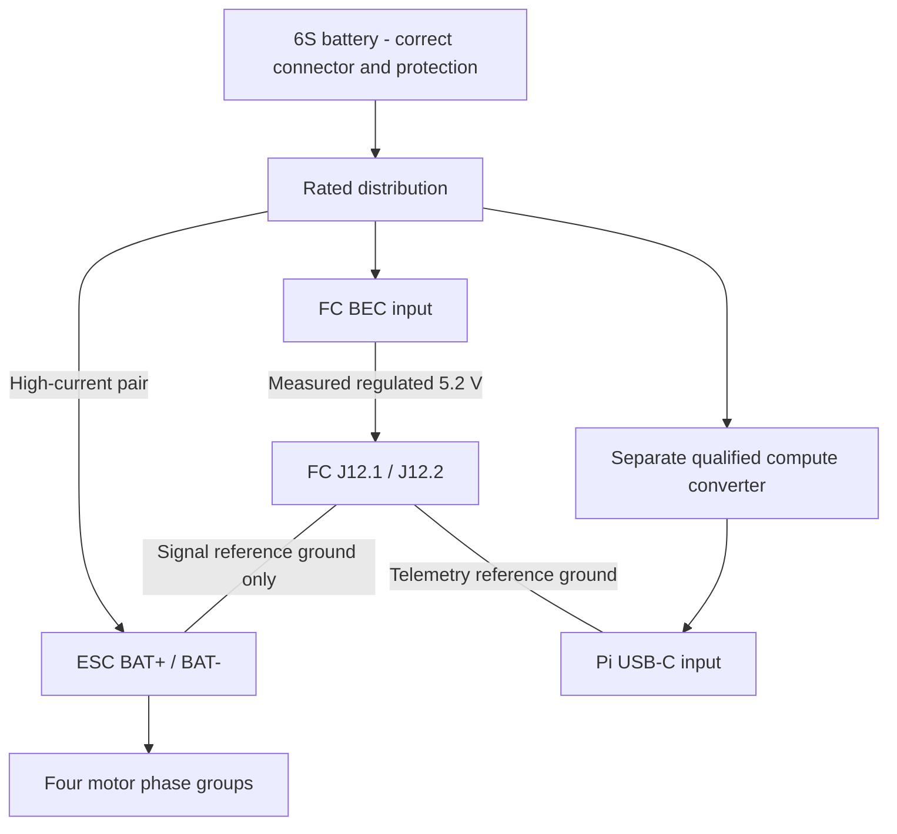


**Phase checklist — mark only after completing the physical test:**

- [ ] UBEC selector and measured output checked with FC disconnected
- [ ] Battery/distribution connector and polarity verified
- [ ] No regulator output paralleling or high-current return through FC harness

**PASS →** Connect only the already-qualified branches in the planned test.

**STOP →** No direct 6S to FC; no thin propulsion adapter; no loaded motor test through an undersized smoke stopper.


Matek specifies 9–55 V input, default 5.2 V output, optional 8/12 V, up to 5 A continuous and no reverse-input protection. A conventional fully charged 6S LiPo is 25.2 V, within its input range, but polarity remains critical.

### E1. Qualify the FC regulator separately

1. Keep the FC disconnected.
2. Inspect the actual BEC and selection pads against Matek's diagram. Leave/select **5.2 V**, not 8 V or 12 V. Do not infer jumper positions from a generic BEC.
3. Using its marked pads, connect supply positive to VIN+ and negative to VIN-/GND. Start from a current-limited source within its specified input range; 12 V is a useful low-energy starting point.
4. Measure output polarity/voltage without the FC. If wrong, power off and fix the selector/wiring.
5. Apply a suitable external test load, inspect temperature and output behaviour; repeat at the intended battery input voltage with appropriate equipment.
6. Connect output+ through the verified harness to J12.1; output- to J12.2.
7. Repeat FC rail/current/boot checks. Add the receiver only after the bare FC passes.

### E2. Battery distribution

```text
6S BATTERY + -> correctly rated connector/distribution -> ESC BAT+
                         |-> BEC-FC VIN+ -> 5.2 V -> FC J12.1
                         |-> qualified PI converter -> Pi USB-C input
6S BATTERY - -> distribution return -> ESC BAT-
                         |-> BEC-FC VIN- -> FC J12.2
                         |-> PI converter return
FC ESC signal ground J6.2 ---------------------------> ESC signal GND
```

Keep high-current ESC returns out of thin FC/telemetry ground wiring. Size connectors, wires, fuse/protection and distribution for measured peak current, not a motor/ESC marketing label. The purchased battery listing contains XT60/XT90 ambiguity; inspect the actual connector before ordering or wiring adapters. Never use a thin adapter for propulsion current.

1. Inspect the pack for damage/swelling and check individual cell voltages with an appropriate balance checker.
2. Charge only with a suitable 6S balance charger and correctly rated leads; do not leave it unattended. Confirm charger input-power requirements separately.
3. With battery disconnected, verify distribution polarity and no short. Insulate all joints and secure the pack.
4. First connect only the proven BEC/FC branch through an appropriate low-current smoke stopper. Verify output/boot, then unplug.
5. Initial ESC electronics checks can use a suitable smoke stopper, but do not interpret its voltage drop as an FC fault.
6. Remove the current-limiting device only for a planned, monitored propulsion test after shorts have been excluded; do not draw motor-test current through an undersized stopper.

A second BEC12S-PRO might be evaluated for compute, but its nominal 5 A label alone does not prove a Pi5+HAT+camera supply. Output voltage at the Pi, transients, cable drop, USB-C power negotiation/current limits, cooling and peripherals all need validation. Keep the official Pi supply for bench work. Never plug a bare BEC wire into USB-C or feed both USB-C and GPIO 5 V simultaneously.

## 9. Phase F — custom ESC and motors, propellers OFF

### ESC test gate: know the delivered custom hardware first

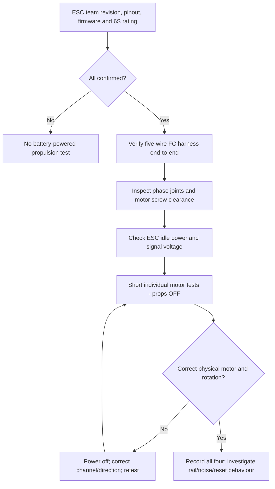


### Harness drawing — logical cavities, not mating-face orientation

```text
FC J6                    CUSTOM ESC
[1 NC]  EMPTY
[2 GND] ──────────────── verified signal GND
[3 NC]  EMPTY
[4 NC]  EMPTY
[5 M1]  ──────────────── channel driving FRONT-RIGHT
[6 M2]  ──────────────── channel driving REAR-LEFT
[7 M3]  ──────────────── channel driving FRONT-LEFT
[8 M4]  ──────────────── channel driving REAR-RIGHT

ESC power is a separate battery pair. No FC J6 VBAT/5V/current wire.
```

### ArduPilot Quad-X: physical position, viewed from above

!ArduPilot Quad-X physical motor map (private source record)

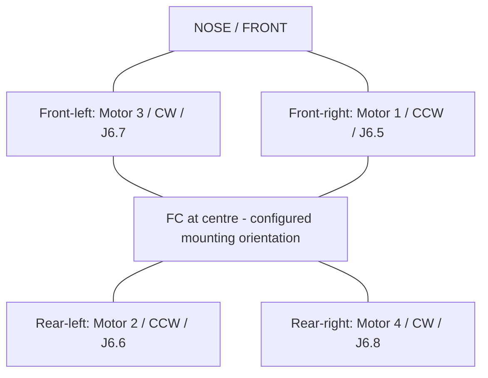


This spatial map is not an electrical schematic. The existing top-view text drawing below is the fallback if your preview does not render Mermaid.

**Phase checklist — mark only after completing the physical test:**

- [ ] Delivered ESC hardware/firmware limits documented
- [ ] Five wires mapped with no unwanted power connection
- [ ] Four individual physical positions and rotations recorded

**PASS →** Proceed to installation and aircraft qualification.

**STOP →** No props, no generic ESC firmware and no assumption that an unloaded spin proves flight thrust.


### F1. Information required from the ESC team

Obtain the exact revision schematic, connector cavity map, battery-voltage limit, gate-driver/MOSFET rating, capacitor rating, actual firmware target/file/hash, supported input protocols, direction configuration and thermal/current qualification. The custom AT32F421 board cannot be safely flashed with an arbitrary AM32 image merely because its MCU is supported. The approximate earlier 30–35 A/channel bench claim is not a qualified 60 A continuous rating.

Ask the team to mark channels A/B/C/D and the corresponding three-phase motor pads. Check recommended input capacitor installation/polarity and voltage derating with their design, not a generic tutorial.

### F2. Exact FC harness

J6 is SM08B-SRSS-TB(LF)(SN), JST-SH 1.0 mm, eight cavities. A matching connector at the ESC does NOT prove its pinout matches.

| FC J6 cavity | EVT1 signal | Destination |
|---|---|---|
| 1 | NC | Empty |
| 2 | GND | ESC signal ground |
| 3 | NC | Empty |
| 4 | NC | Empty |
| 5 | M1 | Input of front-right motor channel |
| 6 | M2 | Input of rear-left motor channel |
| 7 | M3 | Input of front-left motor channel |
| 8 | M4 | Input of rear-right motor channel |

Make a FIVE-WIRE harness, depinning the three unused cavities. Map both ends by continuity. In particular, any ESC-side VBAT/+5V/current-output cavity must not end at an FC signal cavity. No generic eight-wire cable until both ends are verified. Keep the released signal harness target at or below 150 mm.

### F3. Motor wiring and mapping

1. Mount motors with screws that do not touch the windings. Verify frame arm thickness and motor thread depth; do not guess length.
2. With everything unpowered, connect each motor's three phase wires to one ESC channel; insulate joints and secure wires away from bells/props.
3. Verify no phase wire is shorted to the frame or battery. Account for the normal low resistance of windings.
4. Power ESC electronics using the team's specified method and inspect idle current/heat. Do not connect the signal cable before confirming the ESC cannot put excessive voltage on it.
5. Connect the verified FC harness. Start with the lowest-risk mutually supported protocol. If the ESC supports normal PWM, validate it before DShot; this requires deliberately changing MOT_PWM_TYPE from the released DShot300 baseline using this firmware's parameter labels. If PWM is not supported, do not use it just for this checklist.
6. Move to DShot300 after signal/protocol verification. DShot does not use PWM throttle calibration. Keep bidirectional DShot/EDT disabled initially.
7. In Mission Planner's Motor Test, choose an individual motor and a very short, low-throttle test. Secure the airframe and clear people/cables. The required starting percentage is motor/ESC-dependent; there is no universal safe spin percentage.
8. Mission Planner can label test sequence A/B/C/D rather than motor number. Use the Quad-X diagram for the selected firmware and verify physical position; do not assume test A means Motor 1.
9. Correct channel mapping before direction. Change rotation using the exact ESC firmware's approved direction setting or swap two phase wires with battery disconnected. Recheck after any change.

ArduPilot Quad-X, looking DOWN from above with the nose forward:

```text
                 FRONT
       Motor 3 CW       Motor 1 CCW
       J6.7             J6.5

       Motor 2 CCW      Motor 4 CW
       J6.6             J6.8
                 REAR
```

This is not Betaflight's motor numbering. Log every channel/position/direction. Test one motor at a time, then all at low power, watching FC rails and resets. No-prop tests cannot prove thrust, loaded current or endurance. Loaded tests require a proper guarded thrust stand, not an aircraft loosely strapped to a table.

Only consider bidirectional DShot after normal DShot is reliable and compatible firmware is confirmed. Verify actual magnetic pole count, RPM scaling and error rates before using RPM filtering. DShot600 is not required for this project.

## 10. Phase G — frame installation and whole-aircraft qualification

### Mechanical, power and flight evidence converge

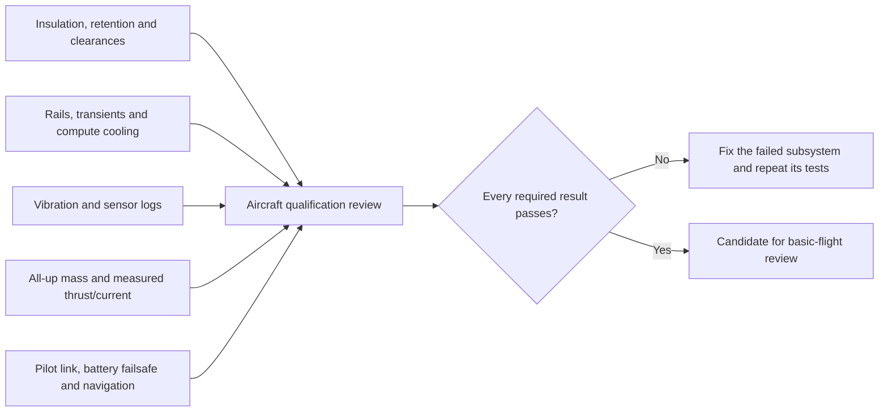


**Phase checklist — mark only after completing the physical test:**

- [ ] FC/ESC/compute insulated and secured
- [ ] Mass, balance and propulsion margin established
- [ ] Loaded power, thermal and vibration evidence reviewed

**PASS →** Continue integration; flight still requires the final independent gate.

**STOP →** A frame fit or motor spin does not establish loaded electrical or flight capability.


1. Fit ESC, FC and compute using their actual mounting dimensions and insulating spacers. Do not assume this custom FC fits a standard stack pattern.
2. Soft-mount the FC appropriately; do not compress damping grommets solid or leave the board moving freely. Record orientation.
3. Keep FC/barometer/GNSS away from ESC switching noise, magnets, high-current loops and Pi fan vibration. Route motor/battery wires away from sensor/serial cables.
4. Fit separate solid mounts for Pi+cooler+HAT and camera/LiDAR. Establish a common documented forward direction.
5. Give FFCs strain relief and protection from sharp carbon edges, bends and propeller sweep. Secure every wire; no flying breadboard jumpers on the aircraft.
6. Leave access to POWER1, USB and battery disconnect. Install antennae clear of carbon and rotating hardware.
7. Install battery retention, anti-slip pad and appropriate straps. Locate the pack to balance the final aircraft, not an empty frame.
8. Weigh everything: pack, frame, motors, ESC, FC, compute, mounts, camera, LiDAR, wiring and extras. Record centre of gravity.
9. Compare measured thrust/current with all-up mass and an engineering thrust/control margin. A 6S 10 Ah pack plus Pi5 assembly can materially change feasibility; a 7-inch frame does not guarantee sufficient margin.
10. Qualify power under representative compute and propulsion load, inspect vibration/logging/temperature and rerun radio failsafe.

The flight gates include valid battery monitoring/failsafe, pilot control and takeover, qualified navigation where required, healthy sensors, stable power, correct motors/props, structural retention and resolved pre-arm warnings. Do not disable checks to make a new custom aircraft arm.

## 11. Phase H — Pi5, camera, AI HAT+ and one SATEL

### Pi connections: three different interfaces

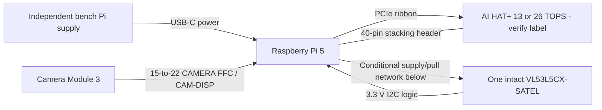


### LiDAR safety decision: intact breakout versus mini-board

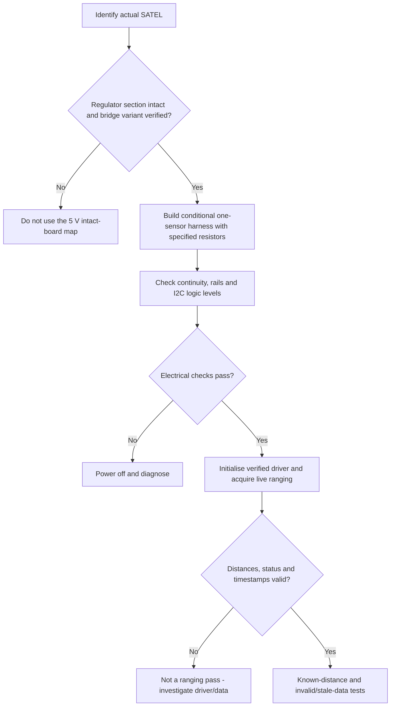


```text
SATEL J1         Connection                    PI PHYSICAL PIN
1 GND            ───────────────────────────── 6 GND
2 IOVDD          ───────────────────────────── 1 3.3 V
3 AVDD input     ───────────────────────────── 2 5 V [INTACT ONLY]
4 PWREN          ──[22 kΩ]───────────────────── 4 5 V
5 LPn            ──[22 kΩ]─────────────────────17 3.3 V
6 SCL            ───────────────────────────── 5 GPIO3
7 SDA            ───────────────────────────── 3 GPIO2
8 I2C_RST        ──[47 kΩ, verify pull network]─ 9 GND
9 INT            EMPTY for polling
```

**Phase checklist — mark only after completing the physical test:**

- [ ] Actual camera and HAT identified and independently tested
- [ ] SATEL intact-board conditions checked before power
- [ ] Live range/status/timestamps and failure behaviour tested

**PASS →** Proceed to telemetry integration and recorded perception tests.

**STOP →** I2C ACK, a detector window or a running Python process is not proof of safe avoidance.


### H1. Compute stack choice

Baseline: Raspberry Pi OS 64-bit, official camera stack, AI HAT+13/26 TOPS with HailoRT, supported packaged YOLOv8 detection demo, ST VL53L5CX ULD/Linux driver, Python/pymavlink for MAVLink, Mission Planner and optionally one MAVLink router. ROS2 is optional later, not needed to establish the first pipeline.

Identify the actual AI HAT label first. AI HAT+2 uses different software; do not install both accelerator package families. Start with a supported packaged model, then select a small supported compiled HEF (for example YOLOv8n) after measuring performance. A random YOLO .pt file does not automatically run on the Hailo accelerator.

### H2. Camera and HAT hardware

1. Shut down Pi and unplug all power before changing ribbons/header connections.
2. Use the purchased 22-to-15-pin CAMERA cable: narrow end into Pi5 CAM/DISP, wide end into Camera Module3. PCIe is a different socket/cable. Follow actual connector contact/latch orientation; do not rely on blue backing colour.
3. Install the cooler, supplied stacking header, spacers and HAT with its PCIe ribbon, following Raspberry Pi's hardware guide. Do not let underside contacts touch a heatsink or frame.
4. Power the bench assembly from the official suitable Pi5 USB-C supply, independent of FC power.

Initial commands (Pi shell, not Windows PowerShell):

```sh
sudo apt update
sudo apt full-upgrade
sudo apt install rpicam-apps dkms hailo-all i2c-tools python3-venv
sudo reboot
```

For AI HAT+13/26 only. After reboot:

```sh
rpicam-hello --list-cameras
rpicam-still -o camera-test.jpg
hailortcli fw-control identify
rpicam-hello -t 0 --post-process-file /usr/share/rpi-camera-assets/hailo_yolov8_inference.json
vcgencmd get_throttled
vcgencmd measure_temp
```

Expected camera for Camera Module3 is IMX708; an earlier buying-list label was ambiguous, so identify the actual sensor. Test focus/exposure/orientation and verify Hailo detection rather than assuming the model ran on the accelerator. Keep kernel, HailoRT, drivers and compiled-model versions compatible; do not mix arbitrary wheels. The demo exits with Ctrl-C. Headless use may require its no-preview option.

### H3. Existing SATEL bench map, with its conditions retained

Earlier photos identify an intact PCB4109A VL53L5CX-SATEL. Its attached regulator section is essential for this 5 V-input wiring. Pin 1 is at the GND end, not the INT end.

| SATEL J1 | Signal | Pi40-pin physical connection |
|---|---|---|
| 1 | GND | 6, GND |
| 2 | IOVDD | 1, 3.3 V |
| 3 | AVDD/regulator input | 2, 5 V, intact regulator board only |
| 4 | PWREN | 4, 5 V through 22 kΩ |
| 5 | LPn | 17, 3.3 V through 22 kΩ |
| 6 | SCL | 5, GPIO3/I2C clock |
| 7 | SDA | 3, GPIO2/I2C data |
| 8 | I2C_RST | 9, GND through 47 kΩ, after checking installed pull network |
| 9 | INT | Unconnected for polling |

This is the project's engineering-adapted static ONE-SENSOR bench arrangement, not an unconditional ST reference harness. Verify regulator variant and solder bridges, resistor values and polarity before applying power. Never connect J1.4 directly to a Pi GPIO or expose any Pi signal to 5 V. A snapped-off sensor mini-board requires a different supply arrangement.

1. Continuity-check every wire with all power off. Confirm no supply-to-ground or 5 V-to-IOVDD/SDA/SCL short.
2. Power and measure IOVDD approximately3.3 V, regulator input approximately5 V, LPn high, reset low and I2C idle around3.3 V; stop for excessive heat/incorrect levels.
3. Enable I2C in `sudo raspi-config`, reboot and use `i2cdetect -y 1` as a connection clue only. Expected default 7-bit address is 0x29 (ST's 8-bit notation is 0x52).
4. Obtain STSW-IMG025/ULD and build a verified Pi5 platform layer as needed. The published Linux package was validated on Pi3, so successful Pi5 ranging is still work to perform; no invented one-command pip installation is supplied here.
5. Acquire timestamped 8×8 distances, status/number-of-target data and actual frame rate. Test measured targets at several distances, angle/position, dark/bright materials, sunlight, floor and no-target situations.
6. Test obstruction of the lens, disconnects, I2C errors and stale frames. All-zero/invalid data is not clear space.
7. Use one sensor first. Two share default address; implement LPn sequencing and readdressing or a suitable multiplexer before paralleling them. The fixed LPn harness above does not provide individual software control.

Keep this breakout map separate from the yet-to-arrive custom LiDAR PCB and custom camera board. Neither inherits SATEL/CameraModule3 wiring automatically.

## 12. Phase I — FC/Pi communication, initially read-only

### Communication sequence: USB first, UART optional

!Optional FC J11 to Pi5 UART connections (private source record)

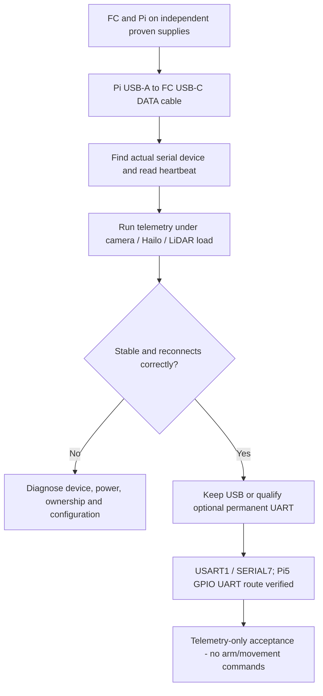


```text
OPTIONAL UART — 3.3 V signals, powered-off wiring
Pi physical 8 / GPIO14 TX  ───────────> FC J11.2 RX
Pi physical10 / GPIO15 RX  <─────────── FC J11.3 TX
Pi physical14 GND          ──────────── FC J11.4 GND
                                     FC J11.1 EMPTY

FC: SERIAL7_PROTOCOL=2; SERIAL7_BAUD=115 (115200 baud)
Pi: verify overlay/device; serial0 is NOT assumed to be pins8/10.
No +5 V wire. SERIAL2 remains the CRSF receiver.
```

**Phase checklist — mark only after completing the physical test:**

- [ ] Heartbeat comes from the intended FC
- [ ] One process/router owns each serial device
- [ ] Load test and disconnect/reconnect behaviour recorded

**PASS →** Begin observation-only MAVLink tests.

**STOP →** No arming or actuator commands are needed to prove communication.


### I1. First prove USB telemetry

1. Keep props removed, motors unpowered and both devices on their proven independent supplies.
2. Connect Pi USB-A to FC USB-C with a data cable. FC still needs J12 power.
3. Find the device:

```sh
ls -l /dev/serial/by-id/
```

Use its actual stable device path rather than assuming ttyACM0. Do not allow two programs to open the same serial port independently. Use one router if both your perception process and Mission Planner need access.

4. Install the MAVLink library in an isolated environment:

```sh
python3 -m venv ~/FC-venv
source ~/FC-venv/bin/activate
python -m pip install pymavlink
```

5. Start with a heartbeat/telemetry-only program. Example, replace SERIAL_DEVICE with the actual by-id path:

```python
from pymavlink import mavutil

link = mavutil.mavlink_connection("SERIAL_DEVICE", baud=115200)
heartbeat = link.wait_heartbeat(timeout=20)
if heartbeat is None:
    raise TimeoutError("No FC heartbeat; check device/power/configuration")
print("FC", link.target_system, link.target_component)
while True:
    msg = link.recv_match(type=["HEARTBEAT", "SYS_STATUS", "ATTITUDE", "STATUSTEXT"],
                          blocking=True, timeout=2)
    if msg is not None:
        print(msg)
```

This receives messages; it does not arm, change modes or send movement commands. Not every telemetry message is streamed by default; deliberate stream-rate requests can be added after heartbeat works. Record actual latency, disconnect/reconnect handling and CPU load.

### I2. Optional permanent UART

J11 is USART1 PB14/PB15, therefore **SERIAL7** in this custom hwdef. Generic ArduPilot tutorials using SERIAL2 are not correct for this port; SERIAL2 is already the receiver.

| FC J11 | Signal | Pi GPIO UART wiring, if configured on pins8/10 |
|---|---|---|
| 1 | NC | Empty |
| 2 | FC RX | Pi physical8 / GPIO14 TX |
| 3 | FC TX | Pi physical10 / GPIO15 RX |
| 4 | GND | Pi physical14 GND or another verified GND |

3.3 V UART logic only; no RS232, no 5 V TTL and no power wire. A verified 3.3 V USB-UART adapter is another option, with its power-output wire disconnected.

1. Configure the Pi5-specific UART route and disable its login console on that UART. Pi5 `/dev/serial0` can refer to the separate debug-header UART, so do not assume it means GPIO14/15. Consult installed overlays/documentation and verify the actual device/pin route. `uart0-pi5` may be appropriate for the installed OS; confirm its availability and mapping before use.
2. In Mission Planner set SERIAL7_PROTOCOL=2 for MAVLink2 and begin with SERIAL7_BAUD=115 (115200). Reboot and verify saved values. Leave SERIAL2_PROTOCOL=23.
3. Power off, wire and continuity-check, then restart and establish heartbeat on the identified Pi UART device.
4. Start at115200 and increase only if needed and proven. Do not blindly start with a generic921600 setting; USART1 is configured NODMA in this build.
5. Recheck power-off leakage/backpower paths and unplugging behaviour. Do not leave a powered Pi driving a long-unpowered FC during development without a reviewed isolation/sequence plan.

Acceptance: stable telemetry at idle and under sustained camera+Hailo+LiDAR load, no FC resets, sensible attitude/status and graceful reconnect. No arming authority is needed to pass this phase.

## 13. Phase J — detection, distance and avoidance architecture

### Responsibility boundary: Pi observes; FC controls flight

!Camera and LiDAR sensing versus FC flight control (private source record)

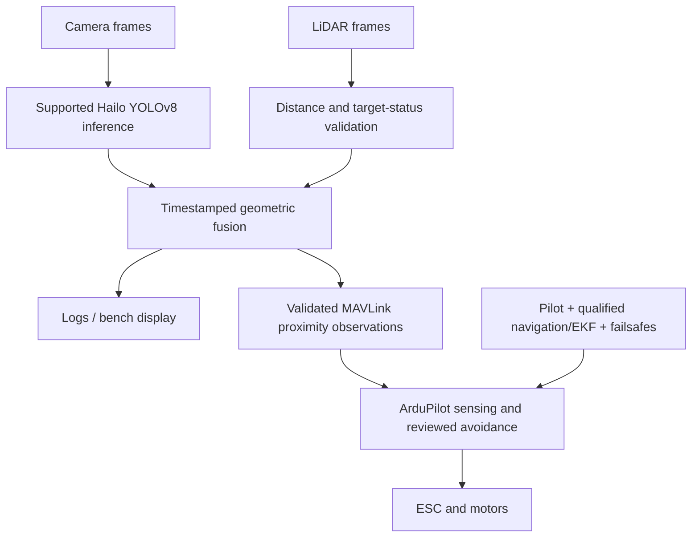


### Validity comes before clearance

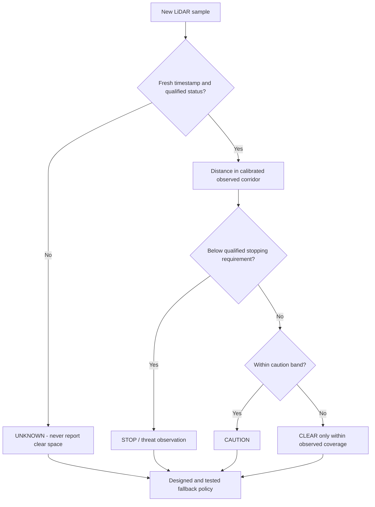


The labels above are bench/decision states, not commands to disarm in flight. Their aircraft actions must be deliberately designed and tested. A missing YOLO detection does not invalidate a close, valid LiDAR obstacle.

### Illustrative speed-versus-distance chart — not measured aircraft performance

Assumptions only: latency 0.15 s, braking acceleration 1.0 m/s² and margin 0.50 m. This table illustrates why increasing speed needs more qualified sensing range.

| Speed (m/s) | Latency distance (m) | Braking distance (m) | Total requirement (m) |
|---:|---:|---:|---:|
| 0.5 | 0.075 | 0.125 | 0.700 |
| 1.0 | 0.150 | 0.500 | 1.150 |
| 1.5 | 0.225 | 1.125 | 1.850 |
| 2.0 | 0.300 | 2.000 | 2.800 |
| 3.0 | 0.450 | 4.500 | 5.450 |

```text
Illustrative required distance; each # is approximately 0.25 m
0.5 m/s | ###                    0.70 m
1.0 m/s | #####                  1.15 m
1.5 m/s | #######                1.85 m
2.0 m/s | ###########            2.80 m
3.0 m/s | ###################### 5.45 m
```

This does not establish LiDAR usable range or drone braking capability. Replace assumptions with verified worst-case measurements before defining a flight envelope.

### No shortcut from detection demo to autonomous flight

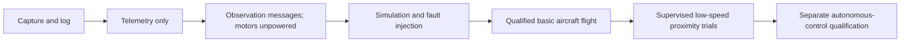


**Phase checklist — mark only after completing the physical test:**

- [ ] Alignment, timestamps, statuses and blind regions handled
- [ ] Messages display correct distance and orientation
- [ ] Simulation, stale-data and pilot-override policies tested

**PASS →** Consider only the next qualified trial stage.

**STOP →** One forward sensor is not 360-degree protection; stock sensor timeout is not a guaranteed stop response.


### J1. Responsibilities

```text
Camera -> Hailo-supported YOLOv8 -> class/box/confidence/timestamp --+
SATEL  -> verified ULD driver   -> distance/status/timestamp -------+-> Pi fusion
                                                                  |-> logs/UI
                                                                  |-> validated proximity messages
                                                                  v
Pilot/GNSS/EKF --------------------------> ArduPilot -> ESC -> motors
```

ArduPilot owns attitude control, motor mixing, flight modes and flight failsafes. The Pi initially supplies observations only. YOLO says what resembles a trained class; it does not establish obstacle range and misses objects outside its labels. LiDAR supplies geometric distance within its limited FoV/range; it does not prove360-degree safety. Never send direct motor-PWM commands from YOLO.

### J2. Fusion and conservative validity

1. Establish camera/LiDAR mounting transforms and forward direction. Calibrate camera intrinsics and geometric alignment; an object's camera pixel coordinates do not trivially equal a ToF zone.
2. Timestamp at acquisition, not after inference. Measure worst-case frame age, processing latency and inter-sensor skew under load.
3. Reject stale frames, malformed grids and unqualified status codes. Validity is separate from distance. Do not represent invalid returns as zero, maximum range or clear.
4. Use a conservative distance statistic within the relevant flight corridor, accounting for zone FoV, target validity and filtering without averaging a nearby obstacle away.
5. Keep detections useful for labelling/tracking; do not require a YOLO label before respecting a valid close ToF return.
6. Distinguish CLEAR / CAUTION / STOP / UNKNOWN in the bench UI. UNKNOWN means autonomous movement is not justified; its actual aircraft response must be explicitly designed and tested.
7. Use hysteresis, confidence/quality checks, bounded filtering and independent watchdogs. Restarting a crashed process is not itself a safety response.

Existing `pi5_perception_bench/decision_core.py`, replay and tests are synthetic bench logic only. Their central4×4 mask, status5 rule and1.5/2.5 m thresholds are demonstration assumptions, not flight-certified constants. They currently send no motor or MAVLink movement commands.

Determine safe speed from measured sensing/braking performance:

`required distance >= speed × worst-case latency + speed²/(2 × proven braking acceleration) + margin`

Illustration only:2 m/s,0.15 s latency,1 m/s² braking and0.5 m margin needs2.8 m. This may already approach practical short-range ToF limits. Bright sunlight, low reflectivity, field of view and missed targets can reduce usable range. Limit speed accordingly; do not promise collision avoidance with an unqualified sensor.

### J3. MAVLink observation publication

1. Verify this actual firmware exposes the proximity parameters. The local4.7.1 source includes a MAVLink backend; a source file alone is not runtime proof.
2. For the direct MAVLink proximity backend, the local source parameter is **PRX1_TYPE=2**. Set/reboot/check only during a planned sensor-integration test. Do not simultaneously configure the same input through another rangefinder/proximity backend.
3. First publish a single correctly oriented forward DISTANCE_SENSOR measurement to test units/orientation/display. Verify the receiving backend accepts it and shows correct distance; never arm for this check.
4. Then evaluate OBSTACLE_DISTANCE for a calibrated horizontal projection of the8×8 grid. Its72 elements are centimetres, unused/unknown bins are65535, and body-mounted data uses MAV_FRAME_BODY_FRD. Measured no-obstacle and unknown are different states. Do not set unobserved rear/side bins to clear.
5. Match angular increment, offset, sensor FoV and row/column orientation to calibrated geometry. Use conservative vertical-zone aggregation that does not conceal overhanging/low obstacles. A grid is not intrinsically a360-degree scan.
6. Test distance/display against ruler-measured targets, then sensor loss, stale data and restart while props remain off. Observe FC timeout behaviour explicitly. Stock proximity data timeout does not guarantee the aircraft stops; define and test the overall pilot/companion fallback.

Use a distinct, documented MAVLink component/system identity for the sensor publisher, rate-limit messages and preserve FC target identification. Do not copy another vehicle's IDs blindly. Keep perception logging and routing ownership clear.

### J4. Control progression

Stage1: capture/detect/range/log, no FC link.

Stage2: FC telemetry-only bench link.

Stage3: sensor-message publication, motors unpowered, avoidance disabled.

Stage4: SITL simulation of clear/blocked/stale/invalid data, pilot override and mode transitions. Prove the message format and decision response without a physical aircraft.

Stage5: configure native ArduPilot proximity avoidance using this firmware's actual parameter descriptions; select the required proximity bit in AVOID_ENABLE and reviewed margin/behaviour. Loiter's simple avoidance and Auto/Guided route planning are different systems. Do not enable BendyRuler/OA_TYPE because it appears in a generic tutorial without validating the mode/navigation/backend.

Stage6: aircraft flight qualification without companion control; Pi can log but has no movement authority.

Stage7: low-speed pilot-supervised proximity trials in a controlled area, no people or hazardous obstacles. Provide a tested proximity-disable/pilot-takeover switch. One front-facing sensor leaves large blind regions; avoid unobserved backing/sideways manoeuvres.

Stage8: separately designed autonomous commands and missions only after estimator, navigation, watchdog, failsafes, command limits and operating envelope are validated. This guide does not implement or validate those flight-control scripts.

## 14. Phase K — final gates and first flight

### Final flight decision: all required domains must pass

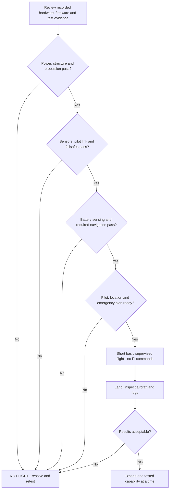


Before installing propellers, independently verify:

- Actual PCB revision, J12 soldering, connector polarity and assembly inspection passed.
- Correct custom bootloader/application installed and parameter backups stored.
- Both IMUs and barometer healthy; orientation/calibrations correct; logs downloadable.
- Receiver binding, channel direction, pilot mode/takeover and link-loss failsafe tested.
- Battery voltage/current source qualified and low/critical actions selected and tested.
- GNSS/yaw/external navigation meets the intended modes; EKF/pre-arm warnings resolved.
- ESC firmware/6S rating/current/capacitors verified; all four motor positions/directions checked.
- Propellers match the motors/directions, with adequate thrust/power margin demonstrated separately.
- FC and Pi supply stability, thermal behaviour, brownout recovery and power sequencing checked.
- Flight wiring mechanically secured; insulation/clearance/antennae/battery retention verified.
- Pi crash/unplugged behaviour cannot unexpectedly arm or command the aircraft.
- Mission Planner logs and test records reviewed; pilot and emergency plan available.

First flight is a separate outdoor/controlled-area operation under an experienced pilot, not an indoor bench experiment. Start with the qualified basic airframe, no autonomous Pi commands, conservative conditions and a short hover appropriate to navigation/mode capability. Land and inspect logs, battery, fasteners, temperatures and vibration before expanding the envelope. Do not attempt obstacle tests near people. Do not tune around a mechanical/power defect.

## 15. Troubleshooting by symptom

| Symptom | Check first | Do not do |
|---|---|---|
| No boot on USB | POWER1 external power, cable, bootloader | Connect6S to FC |
| Supply hits limit | Polarity, shorts, hot parts, transient versus sustained draw | Raise limit blindly |
| STLINK cannot connect | J3 pin mapping, VTref3.3V, GND, clock, reset | Change protection/option bytes casually |
| USB works then resets | POWER1 rail transient, connector/drop, firmware messages | Assume USB is redundant power |
| Missing IMU/baro | Actual part/rotation/joints, rails, exact firmware | Disable health checks to fly |
| No receiver channels |5V compatibility, crossedTX/RX, SERIAL2CRSF, binding | Change companion SERIAL7 randomly |
| ESC silent/no spin | Team firmware/rating, battery power, five-wire map, protocol | Flash generic MCU-matching ESC firmware |
| Wrong motor position | ArduPilot Quad-X mapping/test sequence | Install props to diagnose |
| Pi UART no heartbeat | SERIAL7, TX/RX cross, Pi5 UART device route,3.3V logic | Assume serial0 uses40-pinUART |
| Camera absent | Correct22-to15FFC/socket/orientation, power-off reseat | Hot-plug ribbons |
| Hailo model fails | HAT identity, driver/runtime/HEF versions | Mix AIHAT+ andAIHAT+2 packages |
| LiDAR ACK but no range | Driver initialization, firmware transfer, reset/LPn/status | Treat ACK or zeros as clearance |
| Avoidance unavailable | Actual compiled parameters, backend/mode/navigation | Copy generic parameters or bypass checks |

## 16. Test record template

```text
Board/aircraft ID:
Date/operator:
Hardware revisions and final BOM:
Firmware files/hashes/version:
Parameter backup filename:
Connected equipment:
Supply input/output and current limit:
Measured5V/3.3V/current/temperature:
Sensors/receiver/navigation status:
Motor channel/position/direction records:
PiOS/kernel/Hailo/model/driver versions:
LiDAR measured-distance/status/latency results:
MAVLink link/device/baud/message-loss results:
Failsafe/disconnect/power-cycle results:
Logs/photos:
Pass/fail and unresolved issues:
Next permitted phase:
```

## 17. Primary references and local evidence

External sources checked for this guide:

- [STLINK-V3SET UM2448, connector pinouts](https://www.st.com/resource/en/user_manual/um2448-stlinkv3set-debuggerprogrammer-for-stm8-and-stm32-stmicroelectronics.pdf)
- [STM32CubeProgrammer](https://www.st.com/en/development-tools/stm32cubeprog.html)
- [Matek BEC12S-PRO specifications](https://www.mateksys.com/?portfolio=bec12s-pro)
- [ArduPilot motor/ESC connections](https://ardupilot.org/copter/docs/connect-escs-and-motors.html)
- [ArduPilot pre-arm checks](https://ardupilot.org/copter/docs/common-prearm-safety-checks.html)
- [ArduPilot companion MAVLink connection](https://ardupilot.org/dev/docs/raspberry-pi-via-mavlink.html) — its generic port/power examples are not this custom board's pin map.
- [ArduPilot simple avoidance](https://ardupilot.org/copter/docs/common-simple-object-avoidance.html)
- [Raspberry Pi camera hardware](https://www.raspberrypi.com/documentation/accessories/camera.html)
- [Raspberry Pi AI HAT hardware](https://www.raspberrypi.com/documentation/accessories/ai-hat-plus.html)
- [Raspberry Pi AI software and packaged YOLO demonstrations](https://www.raspberrypi.com/documentation/computers/ai.html)
- [Raspberry Pi UART configuration](https://www.raspberrypi.com/documentation/computers/configuration.html#configuring-uarts)
- [ST SATEL data brief](https://www.st.com/resource/en/data_brief/vl53l5cx-satel.pdf)
- [ST SATEL schematic](https://www.st.com/resource/en/schematic_pack/vl53l5cx-satel-schematics.pdf)
- [ST Linux LiDAR driver](https://www.st.com/en/embedded-software/stsw-img025.html)
- [MAVLink OBSTACLE_DISTANCE specification](https://mavlink.io/en/messages/common.html#OBSTACLE_DISTANCE)

Local evidence, relative to this guide's directory:

- Hardware/Flight Controller.kicad_pcb — current connector pad nets/testpoints.
- Hardware/MCU.kicad_sch and other schematic sheets.
- FC_AUDIT/reports/evt1-connectivity-assertions.md — released electrical changes.
- FC_FAB_OUTPUT/ENGINEERING_VALIDATION_EVT1/firmware/board/hwdef.dat — actual serial/output/sensor mapping.
- FC_FAB_OUTPUT/ENGINEERING_VALIDATION_EVT1/firmware/board/defaults.parm.
- FC_FAB_OUTPUT/ENGINEERING_VALIDATION_EVT1/firmware/EVT1_FIRMWARE_README.md and manifests.
- FC_FAB_OUTPUT/ENGINEERING_VALIDATION_EVT1_PCBWAY/documents/Physical_Validation_Worksheet.md — design qualification targets, not completed tests on these JLC boards.
- pi5_perception_bench/CONNECTIONS.md, README.md, decision_core.py and synthetic tests.
- FC_AUDIT/tools/ardupilot-Copter-4.7.1/libraries/AP_Proximity/AP_Proximity_Params.cpp — local PRX1_TYPE2 MAVLink metadata.

This document adds a staged test procedure; it does not modify the PCB, existing connections guide, firmware or parameter files, and no hardware tests were performed while writing it.


## 18. Session checklist — fill in actual results, not expectations

| Phase | Not started / In progress / Passed / Failed | Evidence filename | Unresolved issue | Next permitted action |
|---|---|---|---|---|
| A Inspection | Not started | — | — | — |
| B First power | Not started | — | — | — |
| C Firmware | Not started | — | — | — |
| D Sensors and receiver | Not started | — | — | — |
| E UBEC and battery | Not started | — | — | — |
| F ESC and motors | Not started | — | — | — |
| G Installation | Not started | — | — | — |
| H Pi perception | Not started | — | — | — |
| I MAVLink | Not started | — | — | — |
| J Avoidance development | Not started | — | — | — |
| K Flight review | Not started | — | — | — |

A status change is an operator record, not automatic verification. Keep failed results and retest evidence; never erase a fault from the history merely because the next attempt worked.
